<div align="center">

<picture>
  <source media="(prefers-color-scheme: dark)" srcset=".github/assets/banner-dark.svg">
  
</picture>

**Read and write NDEF tags through one lifecycle-safe API.**<br>
Run bounded NFC sessions, parse typed records and handle platform capability differences without leaking native session objects.

[](https://packagist.org/packages/pushinbr/pam-native-nfc)
[](https://github.com/push-in/pam-native-nfc/releases/latest)

[](https://github.com/push-in/pam-native-nfc/actions/workflows/ci.yml)
[](LICENSE)

[Install](#install) · [Quick example](#quick-example) · [Platforms](#platform-support) · [Permissions](#requirements) · [API](#api-guide) · [Issues](https://github.com/push-in/pam-native-nfc/issues)

</div>

<a id="install"></a>
## <picture></picture> Install

Inside a PAM Native project, add only this capability:

```sh
pam composer require pushinbr/pam-native-nfc
pam doctor --fix
```

New to PAM? Follow the [five-minute PAM Native setup](https://push-in.github.io/pam-docs/native/overview/) once (`pam init my-app --template native`), then come back here. Your application stays a normal Composer project with a committed lockfile; `pam doctor --fix` refreshes the generated native integration. Use `pam packages` to inspect availability.

<a id="quick-example"></a>
## <picture></picture> Quick example

```php
use Pam\Native\Nfc\{NdefRecord, Nfc, NfcAvailability, NfcEvent, NfcEventKind};

$nfc = new Nfc();

$nfc->availability(function (NfcAvailability $availability) use ($nfc): void {
    if ($availability === NfcAvailability::Available) {
        $nfc->beginRead(fn (bool $ok, ?string $error) => null);
    }
});

$nfc->write(NdefRecord::uri('https://pam.dev'), fn (bool $ok, ?string $error) => null);

$nfc->poll(function (array $events): void {
    foreach ($events as $event) { /** @var NfcEvent $event */
        if ($event->kind === NfcEventKind::TagDiscovered) {
            handleRecords($event->records); // list<NdefRecord>
        }
    }
});
```

Only one NFC session may be active at a time. iOS presents the system NFC sheet and requires the NFC capability in the signing profile. Android uses reader mode and requires a foreground Activity. The queue is bounded to 128 events. NDEF payloads are limited to 1 MiB in PHP before reaching native code; the physical tag's capacity is checked at write time.

<a id="platform-support"></a>
## <picture></picture> Platform support

| Platform | Support | Notes |
| --- | --- | --- |
| Android | API 26+ | Android NFC reader mode; foreground Activity required |
| iOS | 15.0+ | Core NFC system sheet; NFC entitlement required |
| PAM Native | 0.8.0 to < 2.0.0 | From `pam-native.plugin.json`; PHP 8.5+ |

<a id="requirements"></a>
## <picture></picture> Permissions and requirements

| Platform | Declared by the plugin |
| --- | --- |
| Android | `android.permission.NFC` |
| iOS | `NFCReaderUsageDescription` ("Allow this app to scan the NFC tags you choose."), entitlement `com.apple.developer.nfc.readersession.formats` = `NDEF`, `TAG` (`ios/App.entitlements`) |

The iOS signing profile must include the NFC Tag Reading capability, and scanning needs a compatible physical device.

<a id="what-you-can-build"></a>
## <picture></picture> What you can build

- Asset and inventory tagging
- Contactless onboarding and pairing
- Smart posters, tickets and physical experiences

| | |
| --- | --- |
| **Best for** | A focused capability you can add to any PAM Native application |
| **Native path** | Android NFC · Core NFC |
| **Application model** | Composer package + generated native integration |
| **Design rule** | Independent module; no feed, vertical or application template bundled |

<a id="api-guide"></a>
## <picture></picture> API guide

| API | Responsibility |
| --- | --- |
| `Nfc` | `availability()`, `beginRead()`, `write()` (1 to 128 records), `poll()` (up to 128 events), `cancel()`. |
| `NdefRecord` | `NdefRecord::uri()` and `NdefRecord::text()`; MIME and external records through the constructor (`tnf`, `type`, `id`, `payload`). |
| `NfcEvent` / `NfcEventKind` | Typed `TagDiscovered`, `WriteCompleted`, `Cancelled` and `Error` events with their records. |
| `NfcAvailability` | `Available`, `Unavailable` or `Disabled`. |

All coded states, kinds and variants are sequential integer-backed enums. Use enum cases in application code; do not depend on raw wire numbers.

<a id="production-rules"></a>
## <picture></picture> Production checklist

- End sessions when the owning screen leaves the foreground.
- Validate every record type, length and payload before use.
- Treat tag data as untrusted external input.
- Run `pam doctor`, `pam test` and a signed release build on every supported platform.
- Exercise denial, cancellation, backgrounding, process restart and offline behavior before release.

Platform SDKs, credentials, entitlements, physical hardware and store configuration remain application responsibilities.

<a id="troubleshooting"></a>
## <picture></picture> Troubleshooting

- **Session will not start:** only one session may be active.
- **iOS cannot scan:** verify the NFC entitlement and a compatible signed device.
- **Write fails:** compare the encoded payload with the physical tag capacity.
- **Native integration is stale:** run `pam doctor --fix`, rebuild the native host and inspect the first reported diagnostic.

<a id="docs"></a>
## <picture></picture> Docs

- [PAM Native overview](https://push-in.github.io/pam-docs/native/overview/)
- [Plugin and native capability model](https://push-in.github.io/pam-docs/native/plugins/)
- [PAM documentation](https://push-in.github.io/pam-docs/introduction/)
- [Changelog](CHANGELOG.md)
- [Report an issue](https://github.com/push-in/pam-native-nfc/issues): security vulnerabilities go through the repository security policy or GitHub private vulnerability reporting, not a public issue

<a id="pam-ecosystem"></a>
## <picture></picture> Part of the PAM ecosystem

PAM runs PHP natively on servers, desktops and phones. This repository is one piece of it.

| [**PAM**](https://github.com/push-in/pam) | [**PAM Desktop**](https://github.com/push-in/pam-desktop) | [**PAM Native**](https://github.com/push-in/pam-native) | [**Ecosystem**](https://github.com/push-in/pam#ecosystem) |
| --- | --- | --- | --- |
| the runtime and CLI | native desktop apps in PHP | native Android and iOS apps in PHP | every official package and plugin |

<sub>Docs: [push-in.github.io/pam-docs](https://push-in.github.io/pam-docs/introduction/) · [Issues](https://github.com/push-in/pam-native-nfc/issues)</sub>

<p align="center"><sub><a href="LICENSE">Apache License 2.0</a> · Made in Brazil by Pushin</sub></p>
